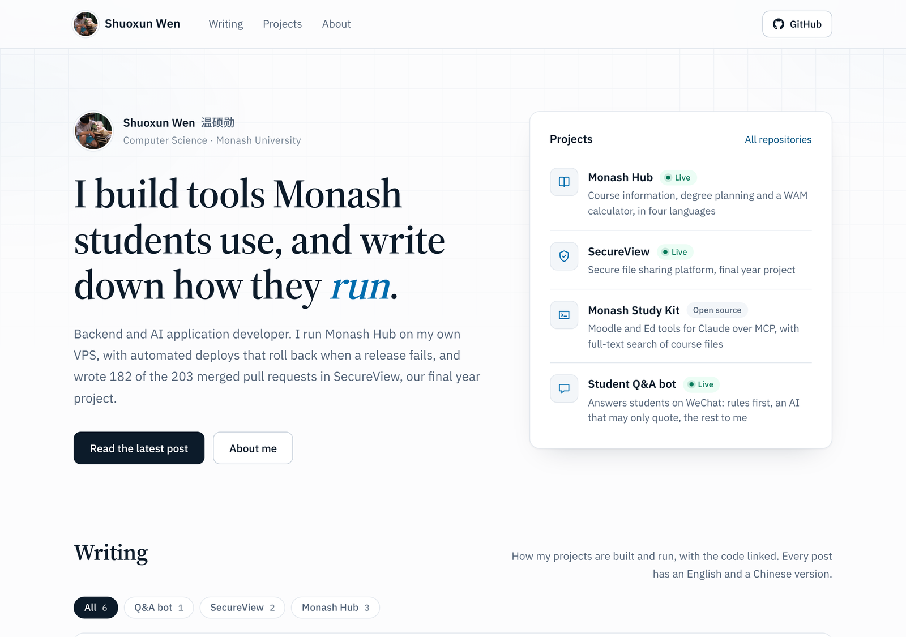

# waldo0926.github.io

[](https://blog.secureview.tech)
[](https://github.com/Waldo0926/waldo0926.github.io/actions/workflows/build.yml)
[](https://jekyllrb.com)



My blog, built by GitHub Pages with Jekyll. It is served at blog.secureview.tech from my VPS: `.github/workflows/build.yml` builds the same site into the `site` branch, and the VPS pulls it every 10 minutes (`deploy/vps/`). waldo0926.github.io keeps working as a mirror. Layouts are in `_layouts/` and the only stylesheet is `assets/style.css`. Posts are in `_posts/`: one English and one Chinese file per post, sharing a `ref` so each links to the other. The English file can set `preview` to show an include from `_includes/preview/` on the home page card. Each post also has a link-preview image in `assets/og/` (`image:` in its front matter), drawn by `node scripts/og.mjs` after adding a post; the build fails if one is missing.

我的博客，用 GitHub Pages 自带的 Jekyll 生成。线上地址 blog.secureview.tech 放在我的 VPS 上：`.github/workflows/build.yml` 把同样的网站构建到 `site` 分支，VPS 每 10 分钟拉一次（`deploy/vps/`）。waldo0926.github.io 继续能打开，当备用。布局在 `_layouts/`，样式只有 `assets/style.css`。文章在 `_posts/`，每篇有英文和中文两个文件，用相同的 `ref` 互相链接。英文文件可以用 `preview` 指定 `_includes/preview/` 里的预览，显示在首页的文章卡片上。每篇文章还有一张分享链接时显示的预览图，放在 `assets/og/`（front matter 里的 `image:`），加文章后跑一次 `node scripts/og.mjs` 生成；缺图的话构建会失败。

Preview locally / 本地预览：

```sh
gem install jekyll jekyll-feed jekyll-seo-tag
jekyll serve
```
