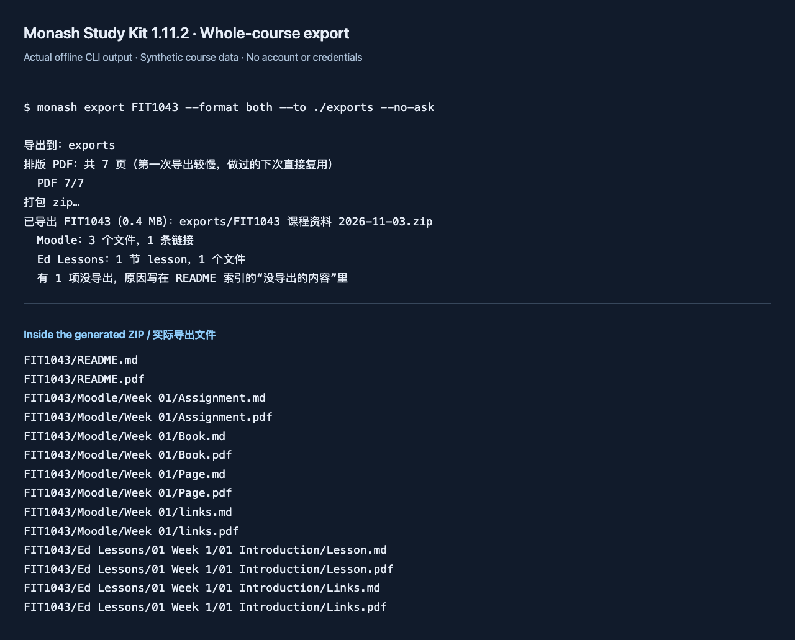

The earlier [Ed export article]() covered lesson folders and a download-all zip. A course has more than Ed files: a Moodle Page containing the brief, a Book with several chapters, a marking guide, pictures embedded in a lesson, and a Google document that is still only a link. Packing the PDFs already on disk leaves all of those behind.

Study Kit 1.8 added a whole-course package. Versions 1.9 through 1.11.1 filled in these gaps and added isolated accounts and PDF output. This article follows the current [source and changelog](https://github.com/Waldo0926/monash-study-kit/blob/main/CHANGELOG.md). It describes the local exporter; private deployment changes and production verification are separate work.

**Release update (3 November 2026):** [1.11.2 is published](https://github.com/Waldo0926/monash-study-kit/releases/tag/v1.11.2), fixing Windows PDF browser cold-start retries. The commands below apply to the current release.



The demo runs offline against synthetic materials, deliberately retaining a missing attachment and an unauthorized Google link to show how omissions are reported.

## Start with a useful command

After installing Study Kit and selecting your units:

```bash
monash export FIT2109 --sync --format both --to "./exports"
```

The destination is a folder, not a zip filename. `--sync` refreshes this unit's Moodle content and Ed Lessons before packaging. It leaves Ed discussions out. Without it, export only reads the local cache. `--dir` writes a directory rather than a zip, and `--open` reveals the result in the file manager.

In 1.11.1 an interactive terminal opens a folder picker if `--to` is absent; `--no-ask` skips it. The starting location is the previous choice or the system Downloads folder, including a relocated Windows Downloads folder. The command prints the destination before work starts and progress while rendering and packing.

## Collect first, package second

There are three stages:

```text
Moodle / Ed / course-linked Google files
                 |
         sync and normalize
                 |
     local files + SQLite metadata
                 |
  export.Plan: entries + missing + statistics
                 |
       optional offline PDF rendering
                 |
    zip or directory, including an index
```

The code is split accordingly: `syncer.py` and `moodle_content.py` collect Moodle materials, the Ed modules collect Lessons, `google_export.py` handles linked Google files, `export.py` plans the package, and `pdfrender.py` prints its Markdown pages. Packaging does not need a live session unless the CLI was explicitly asked to sync first.

Moodle Page, Book and assignment bodies become Markdown. The Book parser uses Moodle's print view, which does not count as viewing individual chapters. Visible rubrics and marking guides are teaching materials too; a student's submissions, grades and private feedback are excluded. Moodle folders use a whole-folder download, retaining subdirectories and original filenames, with individual-file fallback when necessary.

Ed lesson pages contribute text, slides, embedded Ed-hosted files and question-only quiz pages. Images from Moodle and Ed are saved under `assets/`, deduplicated by content, and linked relatively. A failed image keeps its remote link and becomes an index entry. Older extensionless Ed images saved as `.img` are renamed from their detected content during sync, rather than remaining files a viewer cannot recognize.

The package has a unit root, `Moodle/`, `Ed Lessons/` and an index. Original PDFs, notebooks, code and archives retain their formats. Generated bodies, link lists, quizzes and the index use the chosen output format.

## A Google link needs its own permission

```bash
uv tool install --reinstall --refresh "monash-study-kit[gmail]"
monash google login
monash export FIT2109 --refresh-google --format both --to "./exports"
```

Keep any other extras you already use in that install command. The optional dependency happens to be named `gmail`; Drive authorization is separate. `monash google login` requests only `drive.readonly` and writes `google-drive-token.json`, independently of Gmail's token. The scope can read all Drive files accessible to the account; the exporter uses course-linked files. It cannot edit them and grants no Gmail access.

Docs and Slides normally become PDF, Sheets XLSX, and ordinary Drive files keep their format. `monash config google_docs_format docx` changes Docs to DOCX. It does not change Slides or the exporter's own Markdown pages. `--refresh-google` implies sync and re-exports linked Google files.

An API export can fail because of file size, a disabled API, administrator policy or sharing permissions. Where supported, the dedicated login browser's Google session is tried as a fallback, with cookies held in memory. It does not bypass sharing permissions. Google Forms remain links with a reason. Logout revokes the Drive authorization before deleting its local token; failed revocation keeps the token so the user can retry.

## PDF is another output, not another sync format

Since 1.11, `pdf` is the initial export default. `--format md` avoids PDF printing; `both` keeps editable Markdown alongside generated PDFs. Synced text and the MCP search index remain unchanged.

One isolated temporary Chrome, Edge or Brave process prints the package's pages offline. Local images are embedded, raw HTML is escaped, and remote requests are blocked. Without a supported browser, export falls back to Markdown and says why in the index and terminal. Version 1.11.1 retries Windows temporary-profile cleanup so a browser helper briefly holding a file does not invalidate an already completed export.

The cache key covers printable HTML and embedded image contents. Replacing a local image therefore changes the key even if the Markdown is identical. Cached PDFs live under `data/pdf-cache/`; oldest entries are evicted above 500 MB. JSON output reports generated and cached PDF counts and the fallback reason. These are implementation limits, not performance measurements.

## Account isolation belongs before imports

```bash
monash --profile exchange setup
monash --profile exchange google login
monash --profile exchange export FIT2109 --sync --to "./exports"
monash profile list
```

Paths are fixed when modules are imported. `entry.py` therefore chooses the profile before importing the CLI and service modules. Named profiles keep credentials, databases, materials and browser sessions under separate `profiles/NAME` directories. They force materials-only mode: no Gmail sync, attendance, Ed discussions or personal-calendar setup. They cannot configure remote serving, `monash connect`, or an independent data-home move.

Cleanup is deliberately a separate command from the default account: `monash profile remove exchange`. It revokes Google tokens before removing login sessions, keeps materials and databases unless `--all` is supplied, and preserves files if revocation fails. Ed API-token deletion remains a manual step.

## Complete also means naming the gaps

The exporter records missing local files, unsynced Ed units, failed Google exports and remaining remote images. Notebook image references that are missing or differ only by case are reported too. A successful zip does not prove that every linked resource was downloadable. Folder refreshes are normally limited to once a week; refreshing Google is not a universal force-refresh switch.

The package excludes personal records and strips meeting-password parameters from links, but its contents are ordinary local files. They are not automatically public or safe to redistribute. Gmail is a separate optional feature: ordinary Gmail login requests `gmail.modify`, while `--read-only` requests `gmail.readonly`.

For this update, the local Study Kit suite completed with **663 passed and 10 skipped**. Those tests cover synthetic export fixtures, Google errors, profiles and PDF behavior; they do not establish that every real course, Google account or Windows installation works. The [bilingual export guide](https://docs.secureview.tech/study-kit/materials/) documents setup, options and retry steps. The practical check after exporting is still to open the index and inspect what was left out.
